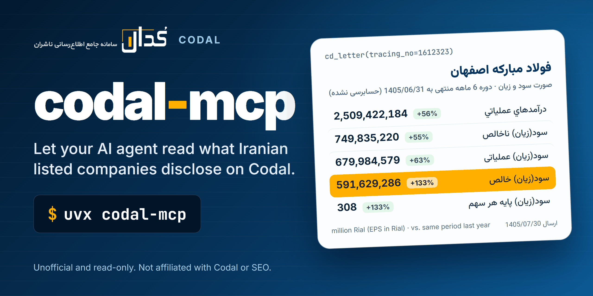

<!-- mcp-name: io.github.sepehr071/codal-mcp -->

<div align="center">



# codal-mcp: Codal (کدال) disclosure and financial statement MCP server for AI agents

**codal-mcp lets an AI agent search and read Codal, the official disclosure system of Iranian listed companies.**<br>
Codal (codal.ir, سامانه جامع اطلاع‌رسانی ناشران) is where companies and funds on the Tehran Stock Exchange, Iran Fara Bourse<br>
and the other Iranian exchanges publish financial statements, monthly activity reports, meeting decisions and material news.<br>
codal-mcp is an unofficial, read-only MCP server with 5 tools that turns those letters into text and tables for Claude, Cursor or Copilot.

[](https://pypi.org/project/codal-mcp/)
[](https://pypi.org/project/codal-mcp/)
[](https://github.com/sepehr071/codal-mcp/actions/workflows/ci.yml)
[](https://registry.modelcontextprotocol.io/?q=codal-mcp)
[](https://github.com/sepehr071/codal-mcp/blob/main/LICENSE)

[](https://vscode.dev/redirect/mcp/install?name=codal&config=%7B%22command%22%3A%22uvx%22%2C%22args%22%3A%5B%22codal-mcp%22%5D%7D)

[For AI agents](#for-ai-agents) · [Quick start](#quick-start) · [What it can do](#what-it-can-do) · [Tools](#tools) · [FAQ](#faq) · [فارسی](#فارسی)

</div>

---

## For AI agents

- **What:** unofficial MCP server (model context protocol) for codal.ir, the disclosure system of companies and funds listed on Iranian exchanges (Tehran Stock Exchange, Iran Fara Bourse, commodity and energy exchanges, and registered unlisted companies).
- **Install:** `uvx codal-mcp` or `claude mcp add codal -- uvx codal-mcp`. Transport: stdio. Needs [uv](https://docs.astral.sh/uv/getting-started/installation/) (Python 3.10+).
- **Auth:** none, no API key or account. Optional `CODAL_MCP_PROXY` (HTTP proxy URL, or a comma-separated list); system proxy settings are ignored.
- **Access:** read-only. It cannot log in or file anything, so no confirmation is needed before calling any tool.
- **Tools:** 5, all prefixed `cd_`. Typical sequence: `cd_company` -> `cd_search_letters` -> `cd_letter`.
  `cd_letter_types` gives letter type ids for filtering; `cd_financial_years` gives a company's fiscal year ends.
- **Use when:** the user asks what a listed company disclosed: its latest interim or annual financial statements, EPS, monthly sales and production, shareholder meeting decisions, dividend schedule, capital increase, or the text of one Codal letter.
- **Do not use when:** the user wants share prices, order books or market indices (use [tsetmc-mcp](https://github.com/sepehr071/tsetmc-mcp)), or wants to trade.
- **Output:** compact JSON with ASCII digits. Dates are Jalali (`YYYY/MM/DD`), Tehran time. Report amounts are as published, usually **million Rial** (see `unit_note`).
- **Rate limit:** codal.ir blocks an IP for up to an hour after a burst of requests. Make few, targeted calls and reuse results. If a tool says codal.ir is rate limiting, stop and wait.
- **Network:** codal.ir often answers only Iranian connections. If requests time out, set `CODAL_MCP_PROXY` to an Iranian HTTP proxy.
- **Machine-readable:** [`server.json`](https://github.com/sepehr071/codal-mcp/blob/main/server.json) and the
  [iran-mcp catalog](https://github.com/sepehr071/iran-mcp).

## Why

Everything an Iranian listed company publishes is on Codal, but behind a search form, Persian digits and report
pages rendered by JavaScript, with one statement sheet per page. Answering "how did Foolad do in the first half of
the year?" means finding the right letter among 1,475 and reading a table on screen. `codal-mcp` searches with the
site's own filters and returns the statement as rows an agent can read:

> **You:** What did Foolad (فولاد) report for its first six months of 1405?
>
> **Agent:** *calls* `cd_search_letters(symbol="فولاد", letter_type=6, period_months=6)` -> `cd_letter(tracing_no=1612323)`
>
> Mobarakeh Steel's unaudited six-month statements to 1405/06/31 (published 1405/07/30) show operating revenue of
> 2,509,422,184 million Rial, 56% more than the same period a year earlier, and a net profit of 591,629,286 million
> Rial, up 133%. Basic earnings per share were 308 Rial.

<sub>Real figures from tracing number 1612323, read with codal-mcp on 2026-10-31 and checked against the letter page on codal.ir.</sub>

## What it can do

- **Search disclosures** of any publisher on Codal, newest first: by symbol, letter group, letter type, words in the title, Jalali date range, report period (1-12 months) or tracing number
- **List the newest letters** of the whole market when no filter is given
- **Read financial statements** as tables, one sheet at a time: income statement, comprehensive income, balance sheet, changes in equity, cash flows and the interpretive report pages, with the unit note and listed capital
- **Read monthly activity reports**: raw material purchases, production and sales by product, energy use and foreign currency sources and uses
- **Read text letters** such as explanations, clarifications and notices, without the page's hidden form templates
- **Get the links** to each letter's page, PDF, Excel file and attachments (with their descriptions and dates)
- **Look up companies and funds** by symbol or name: ISIC code, market, kind, industry and reporting type
- **List letter groups and letter types** with the ids the search takes, and a company's fiscal year ends
- **Read-only by design**: no login, no captcha solving

Example prompts:

- "What did Foolad report in its latest interim financial statements?"
- "Show the balance sheet from that letter."
- "List Iran Khodro's monthly activity reports for 1405."
- "Which companies published monthly activity reports this week?"
- "When does Foolad's fiscal year end, and when were its last annual statements published?"
- <span dir="rtl">آخرین صورت‌های مالی میان‌دوره‌ای فولاد در کدال چه بود؟</span>
- <span dir="rtl">گزارش فعالیت ماهانه مهر ۱۴۰۵ ایران خودرو را بیاور.</span>
- <span dir="rtl">تصمیمات آخرین مجمع عمومی سالیانه فولاد را از کدال بخوان.</span>

## Quick start

You need [uv](https://docs.astral.sh/uv/getting-started/installation/). No API key or account.

<details open>
<summary><b>Claude Code</b></summary>

```bash
claude mcp add codal -- uvx codal-mcp
```
</details>

<details>
<summary><b>Claude Desktop</b></summary>

Settings → Developer → Edit Config, then add:

```json
{
  "mcpServers": {
    "codal": { "command": "uvx", "args": ["codal-mcp"] }
  }
}
```
</details>

<details>
<summary><b>Cursor</b></summary>

Add the Claude Desktop block above to `~/.cursor/mcp.json` (or `.cursor/mcp.json` in a project).
</details>

<details>
<summary><b>VS Code (Copilot agent mode)</b></summary>

Click **Install in VS Code** above, or add to `.vscode/mcp.json`:

```json
{
  "servers": {
    "codal": { "type": "stdio", "command": "uvx", "args": ["codal-mcp"] }
  }
}
```
</details>

<details>
<summary><b>Codex CLI</b></summary>

```bash
codex mcp add codal -- uvx codal-mcp
```

Or in `~/.codex/config.toml`:

```toml
[mcp_servers.codal]
command = "uvx"
args = ["codal-mcp"]
```
</details>

<details>
<summary><b>Gemini CLI</b></summary>

Add to `~/.gemini/settings.json`:

```json
{
  "mcpServers": {
    "codal": { "command": "uvx", "args": ["codal-mcp"] }
  }
}
```
</details>

<details>
<summary><b>Windsurf</b></summary>

Add the Claude Desktop block to `~/.codeium/windsurf/mcp_config.json`.
</details>

<details>
<summary><b>Anything else</b></summary>

It is a standard stdio MCP server: run `uvx codal-mcp`, or `pip install codal-mcp` and run `codal-mcp`.
</details>

## Tools

Pass the trading symbol in Persian (`فولاد`, `خودرو`). Dates are Jalali `YYYY/MM/DD`; Persian digits are accepted.

| Tool | What it does |
|---|---|
| `cd_search_letters` | Search codal.ir disclosures (letters) of Iranian listed companies, newest first, 20 per page |
| `cd_letter` | Read one codal.ir letter: its text or tables, plus links to its page, PDF, Excel and attachments |
| `cd_company` | Find companies and funds on codal.ir by symbol or name, with their market, industry and type |
| `cd_letter_types` | List codal.ir letter groups, or the letter types of one group with the ids `cd_search_letters` takes |
| `cd_financial_years` | List the fiscal year-end dates codal.ir knows for one company, newest first (Jalali) |

All 5 tools are annotated `readOnlyHint: true`.

## How it works

```text
  AI agent  (Claude, Cursor, Copilot, ...)
      │
      │  MCP over stdio
      ▼
  codal-mcp  (runs on your machine)
      │
      │  HTTPS, one request at a time, at least 2 s apart
      ├──────▶  search.codal.ir   search API, company list, letter types, fiscal years
      └──────▶  www.codal.ir      letter pages, sheets, attachment lists
```

`codal-mcp` runs locally and calls the same search API and letter pages the codal.ir website uses. It has no hosted
server in between and no API key. Structured reports carry their tables as data inside the letter page; the server
reads that data and returns each row as one line, in the site's column order. Other letters come back as their
visible text. Requests go out through a Chrome-impersonating client, only to `search.codal.ir` and `www.codal.ir`.
It only reads.

## Good to know

- **Rate limit.** codal.ir answers HTTP 429 and shows a captcha after a burst of requests, then blocks the IP for up to an hour. The server sends one request at a time, at least 2 seconds apart, keeps the company list and letter types for 12 hours, letters for an hour and searches for 2 minutes, and never retries a 429. After a 429 it stops calling codal.ir for 10 minutes and tells the agent to wait. It never solves captchas.
- **Iranian connection.** codal.ir often does not answer connections from outside Iran (from a foreign VPN exit, requests timed out in our tests). Set `CODAL_MCP_PROXY` to an HTTP proxy with an Iranian exit. System proxy variables are ignored on purpose.
- **Units.** Statement and report amounts are as published, usually million Rial; `unit_note` quotes the page. EPS is in Rial. Divide Rial by 10 for Toman.
- **Tables are text.** Each table row is one line with cells separated by ` | `. Numbers have no thousands separators, and negatives are `-N` where the site shows `(N)`. Income statements have two «درصد تغيير» columns: change against the same period last year and against the last full year.
- **One sheet at a time.** Financial statements are split into sheets; `cd_letter` returns the list of `sheets` and takes `sheet` to read another one (for example `0` for the balance sheet).
- **Attachments are listed, not read.** Explanation letters often carry their content in an attached image or PDF. `cd_letter` returns the links.
- **Long letters** are cut at 16,000 characters (`truncated`); the PDF link has the whole letter.
- **Search tips.** `period_months=12` finds annual reports, `6` half-year and `3` quarterly; `title` matches words in the letter title. `cd_letter_types` lists letter type ids (6 financial statements, 58 monthly activity report, 20 annual general meeting decisions).
- **Persian text.** Letter text is returned as the company wrote it, including Arabic ي/ك. Digits are converted to ASCII.
- **What it does not do:** no share prices (see tsetmc-mcp), no XBRL parsing, no reading of attached files, no login and no captcha solving.

## FAQ

<details>
<summary><b>What is Codal (کدال)?</b></summary>

Codal (codal.ir, سامانه جامع اطلاع‌رسانی ناشران) is the official disclosure system run under Iran's Securities and
Exchange Organization (SEO). Companies and funds listed on the Tehran Stock Exchange, Iran Fara Bourse and the other
Iranian exchanges publish their financial statements, monthly activity reports, meeting notices and decisions,
capital increases and material news there. About 5,400 publishers are on it.
</details>

<details>
<summary><b>How can an AI read a company's financial statements from Codal?</b></summary>

Add `codal-mcp` to your agent, then ask in plain language. The agent finds the letter with `cd_search_letters`
(for example `symbol="فولاد", letter_type=6, period_months=6`) and reads it with `cd_letter(tracing_no=...)`, which
returns the income statement as rows; `sheet=0` gives the balance sheet.
</details>

<details>
<summary><b>Is there an official Codal API?</b></summary>

There is no documented public API. `codal-mcp` uses the same search API and letter pages that the codal.ir website
uses, without login, and returns compact JSON.
</details>

<details>
<summary><b>Does it work outside Iran?</b></summary>

Often not directly: codal.ir did not answer requests from a foreign VPN exit in our tests. Run it on an Iranian
connection, or set `CODAL_MCP_PROXY` to an HTTP proxy with an Iranian exit.
</details>

<details>
<summary><b>Why does it say codal.ir is rate limiting?</b></summary>

codal.ir blocks an IP for up to an hour after many requests in a short time. The server spaces and caches requests
to avoid it; if it still happens, wait and ask again with fewer calls. Results you already have stay valid.
</details>

<details>
<summary><b>How is it different from tsetmc-mcp?</b></summary>

[tsetmc-mcp](https://github.com/sepehr071/tsetmc-mcp) gives market data from the Tehran Stock Exchange: prices,
order book, trades and indices. `codal-mcp` gives what the companies themselves publish: statements, reports and
notices. Use both for a full picture of a stock.
</details>

<details>
<summary><b>Does it parse XBRL or give financial ratios?</b></summary>

No. It returns the tables as the site shows them; the agent can compute ratios from the rows. For a spreadsheet,
use the `excel` link that `cd_letter` returns.
</details>

<details>
<summary><b>Can it give investment advice?</b></summary>

No. It only reads what companies published. Nothing it returns is financial advice.
</details>

<details>
<summary><b>How do I debug what the agent sees?</b></summary>

```bash
npx @modelcontextprotocol/inspector uvx codal-mcp
```
</details>

## Configuration

| Variable | Default | Meaning |
|---|---|---|
| `CODAL_MCP_PROXY` | unset | Optional HTTP proxy URL for codal.ir requests; system proxy settings are ignored. A comma-separated list is used one at a time: the next proxy takes over when one is blocked or cannot connect |

<a id="فارسی"></a>

## فارسی: سرور MCP کدال برای دستیار هوش مصنوعی

<div dir="rtl">

پروژه **codal-mcp** یک سرور MCP غیررسمی و فقط‌خواندنی برای کدال (codal.ir) است، سامانه‌ای که شرکت‌ها و صندوق‌های بورس تهران، فرابورس و بقیه بورس‌های ایران اطلاعیه‌ها و صورت‌های مالی خود را در آن منتشر می‌کنند. با این سرور، دستیار هوش مصنوعی شما (Claude، Cursor، Copilot و ...) اطلاعیه‌های کدال را جستجو می‌کند و متن و جدول‌های آن‌ها را می‌خواند.

**چه کارهایی می‌کند**

- **جستجوی اطلاعیه‌ها** با نماد، گروه و نوع اطلاعیه، کلمه‌های عنوان، بازه تاریخ شمسی، طول دوره گزارش یا شماره پیگیری؛ جدیدترین‌ها اول.
- **خواندن صورت‌های مالی** به شکل جدول، هر بار یک برگه: سود و زیان، وضعیت مالی، جریان‌های نقدی و بقیه برگه‌ها.
- **خواندن گزارش فعالیت ماهانه**: خرید مواد اولیه، تولید و فروش هر محصول، مصرف انرژی و منابع و مصارف ارزی.
- **متن اطلاعیه‌های توضیحی** و شفاف‌سازی، همراه با لینک PDF، فایل اکسل و پیوست‌ها.
- **جستجوی شرکت‌ها و صندوق‌ها** با نماد یا نام، با کد آیسیک، بازار، صنعت و سال‌های مالی.

**نکته‌ها**

- فقط اطلاعات منتشرشده را می‌خواند؛ وارد حسابی نمی‌شود و توصیه سرمایه‌گذاری نیست.
- مبلغ‌ها همان‌طور است که در کدال آمده، معمولاً میلیون ریال. تاریخ‌ها شمسی است.
- کدال بعد از تعداد زیادی درخواست، دسترسی را تا یک ساعت می‌بندد. این سرور درخواست‌ها را یکی‌یکی و با فاصله دست‌کم ۲ ثانیه می‌فرستد و نتیجه را نگه می‌دارد.
- کدال معمولاً فقط به اینترنت ایران جواب می‌دهد. اگر درخواست‌ها بی‌جواب ماند، متغیر `CODAL_MCP_PROXY` را روی یک پراکسی HTTP با خروجی ایران بگذارید.
- کلید API لازم نیست و سرور روی سیستم خود شما اجرا می‌شود.

**نصب** (اول [uv](https://docs.astral.sh/uv/getting-started/installation/) را نصب کنید). در Claude Code:

</div>

```bash
claude mcp add codal -- uvx codal-mcp
```

<div dir="rtl">

در Claude Desktop، Cursor و بقیه برنامه‌ها همان تنظیم بخش [Quick start](#quick-start) را بگذارید.

**نمونه پرسش‌ها**

- «آخرین صورت‌های مالی شش‌ماهه فولاد را بیاور و سود خالص را با پارسال مقایسه کن.»
- «ترازنامه همان اطلاعیه را هم نشان بده.»
- «گزارش‌های فعالیت ماهانه ایران خودرو در سال ۱۴۰۵ را فهرست کن.»
- «این هفته کدام شرکت‌ها گزارش فعالیت ماهانه منتشر کرده‌اند؟»
- «سال مالی فولاد کی تمام می‌شود؟»

</div>

## Development

```bash
git clone https://github.com/sepehr071/codal-mcp && cd codal-mcp
uv sync
uv run ruff check . && uv run ruff format --check .
uv run python -m pytest -q          # offline unit tests on recorded codal.ir pages
uv run python -m pytest -m live -q  # one pass over every tool against codal.ir (about 8 requests)
uv build
```

All tools live in `src/codal_mcp/codal.py`; all HTTP, pacing and caching in `src/codal_mcp/http.py`. Keep the live
suite small: codal.ir rate-limits hard. Issues and PRs are welcome.

Releases: bump the version in `pyproject.toml` and `server.json`, then push a `v*` tag. GitHub Actions publishes to PyPI.

## Related servers

- [tsetmc-mcp](https://github.com/sepehr071/tsetmc-mcp) for Tehran Stock Exchange prices, order book, real vs legal trading and indices
- [iran-tax-mcp](https://github.com/sepehr071/iran-tax-mcp) for Iranian tax data: goods IDs and VAT, activity codes, property values and tax laws
- [iran-mcp](https://github.com/sepehr071/iran-mcp): catalog of all Iranian-service MCP servers

## Disclaimer

Unofficial and not affiliated with or endorsed by Codal or the Securities and Exchange Organization of Iran (SEO).
It is read-only and uses the search API and pages of the codal.ir website, which can change without
notice. Data is informational. Nothing here is financial advice.

## Author

<a href="https://www.linkedin.com/in/sepehr-radmard"></a>

Built and maintained by **Sepehr Radmard** (سپهر رادمرد). Connect on [LinkedIn](https://www.linkedin.com/in/sepehr-radmard) or follow [@sepehr071 on GitHub](https://github.com/sepehr071) for more MCP servers for Iranian websites, all listed in [iran-mcp](https://github.com/sepehr071/iran-mcp). If this saves you time, a star on the repo helps other people find it.

## License

[MIT](https://github.com/sepehr071/codal-mcp/blob/main/LICENSE)
